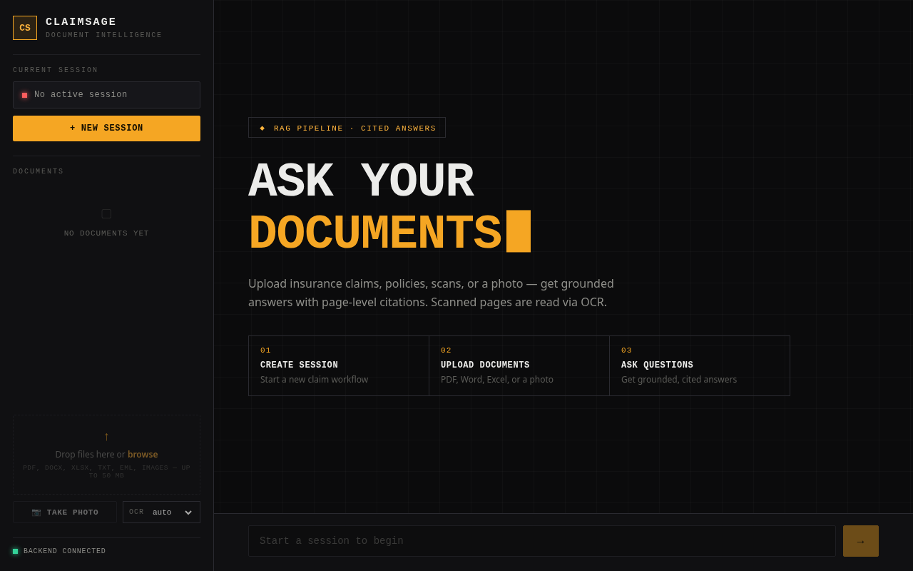

# ClaimSage

**Document-grounded Q&A over insurance claims.** Upload large documents in any
format (PDF, Word, Excel, email, text, or a **photo of a document**), ask
natural-language questions, and get fast, accurate answers grounded in your
documents **with page-level citations**.

Built to demonstrate a real **RAG (Retrieval-Augmented Generation)** system:
embeddings, a vector store, semantic search, chunking strategy, multi-format
ingestion, OCR for scanned documents, a React frontend, and a full cloud
deployment — all running on **free tiers**.

### 🔗 Live demo → **https://claim-sage-six.vercel.app**

> First load may take ~50s — the free backend cold-starts after inactivity, then
> it's instant.



*The live app before a session is started. Upload and Q&A need the backend and Qdrant to be up (see
[Limitations](#limitations)).*

**New here?**
- [`docs/ARCHITECTURE.md`](docs/ARCHITECTURE.md) — how RAG works and how each part
  of this system fits together.
- [`docs/LEARNING_GUIDE.md`](docs/LEARNING_GUIDE.md) — a from-scratch guide to
  building an app like this, **including every bug we hit and how we fixed it**.
- [`docs/DEPLOY.md`](docs/DEPLOY.md) — how the live deployment is wired up.
- [`docs/README.md`](docs/README.md) — index of every doc, and which one to read for what.

### 📥 Download the docs (PDF)

Prefer to read offline or print? Every doc is available as a PDF in
[`docs/pdf/`](docs/pdf):

- [ClaimSage — Architecture](docs/pdf/ClaimSage-Architecture.pdf)
- [ClaimSage — Learning Guide](docs/pdf/ClaimSage-Learning-Guide.pdf) *(the big one — concepts, build order, bug journal, and the beginner course)*
- [ClaimSage — Deploy runbook](docs/pdf/ClaimSage-Deploy.pdf)

---

## Stack

| Layer | Choice |
|---|---|
| Frontend | React · Vite · TypeScript (deployed on **Vercel**) |
| Backend | Python 3.12 · FastAPI (Docker, deployed on **Render**) |
| RAG framework | LlamaIndex |
| Vector store | Qdrant (local Docker in dev · **Qdrant Cloud** in prod) |
| OCR | Tesseract (scanned PDFs + image/camera uploads) |
| Registry | SQLite |
| Chat model | `google/gemma-4-26b-a4b-it:free` (OpenRouter) |
| Embeddings | `nvidia/llama-nemotron-embed-vl-1b-v2:free` (OpenRouter, 2048-dim) |

Everything runs on **free tiers**: OpenRouter free models + Qdrant Cloud free
cluster + Render/Vercel free hosting.

### Architecture

```
 Browser ──HTTPS──▶ Vercel (React/Vite frontend)
                        │  fetch(VITE_API_URL)
                        ▼
                   Render (FastAPI + Tesseract, Docker)
                    │            │
                    ▼            ▼
              Qdrant Cloud   OpenRouter
              (vectors)      (LLM + embeddings)
```

---

## Quick start

### 1. Prerequisites
- Docker Desktop (for Qdrant)
- Python 3.12
- A free [OpenRouter](https://openrouter.ai) API key
- **Tesseract** for OCR of scanned PDFs / image uploads — `brew install tesseract`
  (macOS) or `apt-get install tesseract-ocr` (Linux). Already bundled in the
  Docker image; only needed for local `uvicorn` runs.

### 2. Configure secrets
```bash
cd backend
cp .env.example .env
# edit .env and set OPENROUTER_API_KEY=sk-or-v1-...
```

### 3. Start Qdrant
```bash
docker compose up -d qdrant
```

### 4. Run the backend
```bash
cd backend
python3.12 -m venv ../backend_venv           # first time only
../backend_venv/bin/pip install -r requirements.txt   # first time only
../backend_venv/bin/uvicorn app.main:app --reload --port 8000
```

Open http://localhost:8000/docs for interactive API docs.

### Or run everything in Docker
```bash
docker compose up --build     # backend + qdrant together
```

### 5. Run the frontend (optional)
```bash
cd frontend
cp .env.example .env.local    # VITE_API_URL=http://localhost:8000
npm install
npm run dev                   # http://localhost:5173
```
`npm run lint` runs Oxlint and `npm run build` type-checks and builds.

### Run the tests
```bash
cd backend
../backend_venv/bin/python -m pytest -q
```
The suite is `tests/test_parsers.py` (PDF page labels, docx, xlsx, email, rejected formats, and the three OCR modes with
Tesseract stubbed). It needs no API key and no network. The API routes, query engine and OpenRouter calls are not
covered by tests yet.

---

## Try it (curl)

```bash
# 1. start a session
SID=$(curl -s -X POST localhost:8000/api/sessions | python3 -c "import sys,json;print(json.load(sys.stdin)['session_id'])")

# 2. upload a document
curl -s -X POST "localhost:8000/api/documents?session_id=$SID" -F "files=@policy.pdf"

# 3. (poll GET /api/documents/{doc_id}/status until "ready")

# 4. ask a question
curl -s -X POST localhost:8000/api/query \
  -H 'Content-Type: application/json' \
  -d "{\"session_id\":\"$SID\",\"question\":\"Is knee surgery covered and what is the waiting period?\"}"
```

---

## Project layout

```
ClaimSage/
├── backend/                         # FastAPI + the RAG pipeline (Docker, deployed on Render)
│   ├── app/
│   │   ├── main.py                  # app + CORS + startup
│   │   ├── config.py                # settings from environment / .env
│   │   ├── api/                     # routes_health, routes_upload, routes_query
│   │   ├── models/                  # db.py (SQLite registry), schemas.py (Pydantic)
│   │   └── services/
│   │       ├── parsers.py           # multi-format -> LlamaIndex Documents
│   │       ├── ocr.py               # Tesseract OCR for scanned pages and images
│   │       ├── indexing.py          # chunking + Qdrant wiring
│   │       ├── ingestion.py         # parse -> chunk -> embed -> store (background)
│   │       ├── query_engine.py      # retrieval + grounded answer + citations
│   │       ├── llm_provider.py      # OpenRouter abstraction (chat + embeddings)
│   │       └── openrouter_embedding.py  # custom embedding (encoding_format fix)
│   ├── tests/test_parsers.py        # parser + OCR-mode tests
│   ├── requirements.txt  Dockerfile  .env.example
├── frontend/                        # React + Vite + TypeScript (deployed on Vercel)
│   └── src/                         # api.ts (typed client), App.tsx, components/{Chat,Sidebar,Uploader}.tsx
├── docs/                            # see docs/README.md for the index
│   ├── ARCHITECTURE.md  DEPLOY.md  LEARNING_GUIDE.md
│   ├── pdf/                         # PDF snapshots of the three docs
│   └── screenshots/
├── docker-compose.yml               # Qdrant + backend for local development
└── render.yaml                      # Render Blueprint for the backend
```

Supported formats: PDF, .docx, .xlsx, .txt, .eml, and images
(.jpg/.jpeg/.png/.tiff/.bmp) (50 MB max).
Legacy binary `.doc` / `.msg` are rejected with a clear message.

**OCR:** scanned PDF pages (no text layer) and image uploads are read via
Tesseract OCR. For PDFs, OCR runs *only* on pages that lack extractable text
(per-page character threshold), so digital pages stay fast and accurate. Control
it per upload with `?ocr_mode=auto|always|off` on `POST /api/documents`
(`auto` is the default).

---

## Limitations

- **Cold starts.** The free Render backend sleeps when idle; the first request can take ~50 seconds.
- **Ephemeral registry.** The SQLite session/document registry and uploaded files live on the instance's disk and
  reset on redeploy or sleep, so each visit starts a fresh session. The vectors persist in Qdrant Cloud.
- **Shared free quota.** Chat and embeddings go through one free OpenRouter key. When its rate limit is hit, the API
  answers 429 with a "rate-limited" message.
- **No authentication.** A session id is the only thing scoping a claim's documents; there are no user accounts.
- **Citations vary by format.** PDFs and images cite a page; Excel cites sheet and row; email cites the field; `.docx`
  and `.txt` are indexed as whole documents, so their citations show the file name only.
- **"Confidence" is retrieval similarity** (the top chunk's score), not a measure of whether the answer is correct.
  Answers are advisory, not claims decisions.
- **No accuracy numbers yet.** The evaluation harness is planned (see Status), so retrieval quality is not measured.
- **The free Qdrant Cloud cluster deactivates after a period of inactivity.** When that happens `/api/health` reports
  `"qdrant": "unreachable"` (the web page still loads and the sidebar still says "Backend connected", because that
  light only checks the API), and uploads and questions fail until the cluster is reactivated. Reactivate it in the
  Qdrant Cloud console. If you create a new cluster instead, update `QDRANT_URL` and `QDRANT_API_KEY` on Render and
  re-upload your documents, because a new cluster starts empty. Check Qdrant's current free-tier policy for the exact
  inactivity window. The same symptom also appears when `QDRANT_URL` or `QDRANT_API_KEY` is wrong.

## Status

**Phase 1 (done):** working end-to-end RAG — multi-format ingestion, async
processing, scoped retrieval, grounded answers with citations.

**Phase 2 (planned):** agentic query routing (LangChain), hybrid search
(BM25 + vector), and an evaluation harness comparing chunking strategies.
